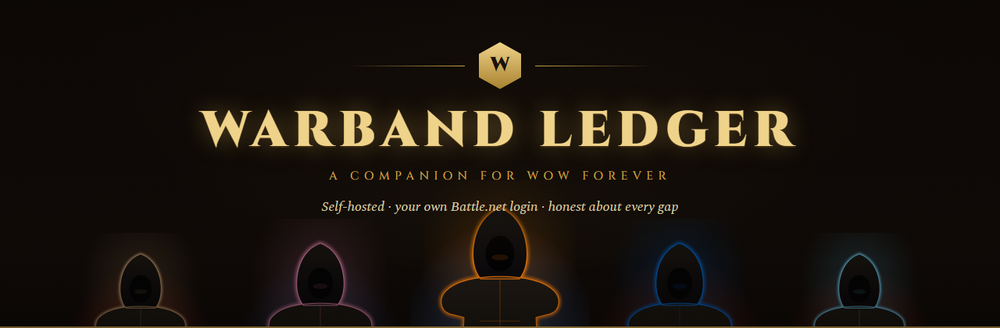
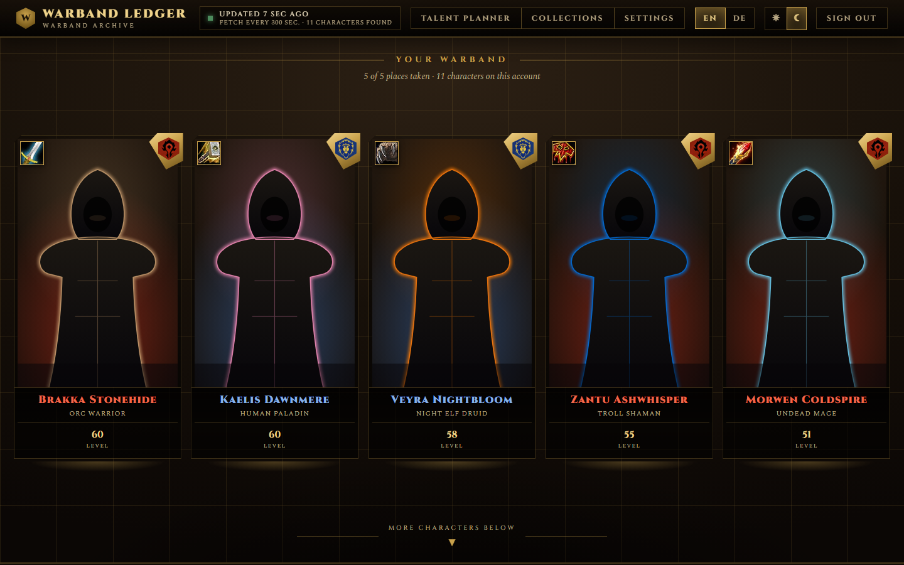
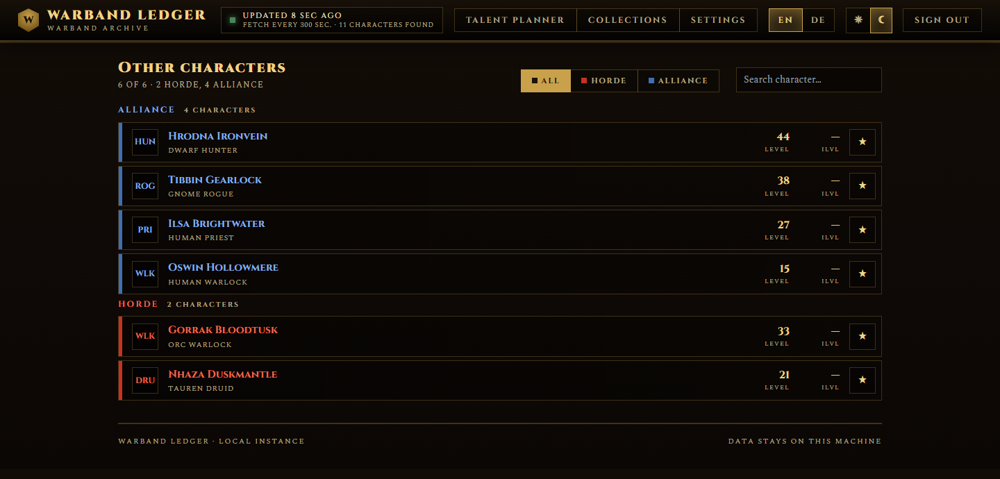
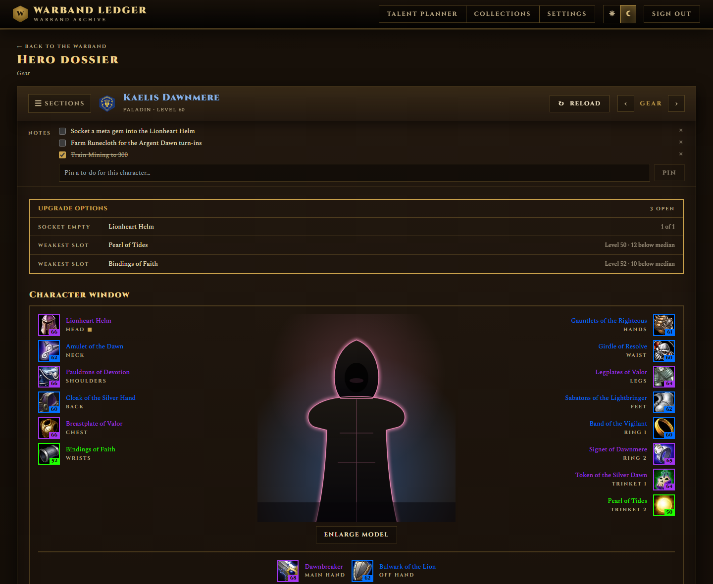
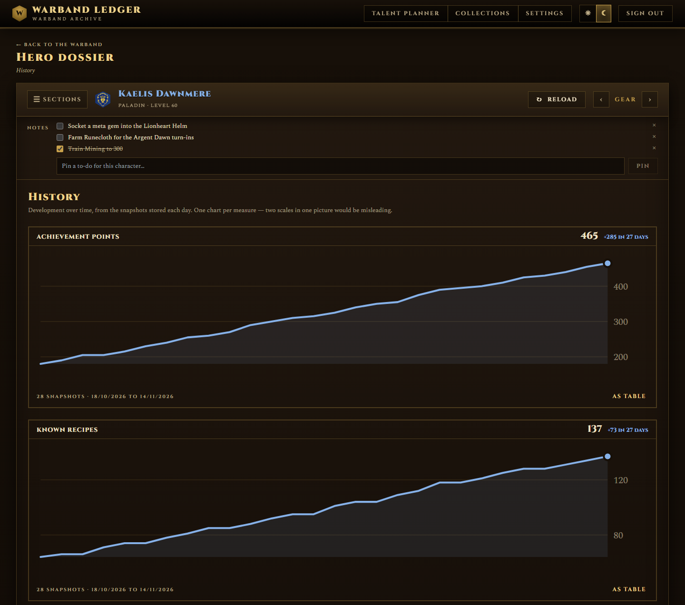
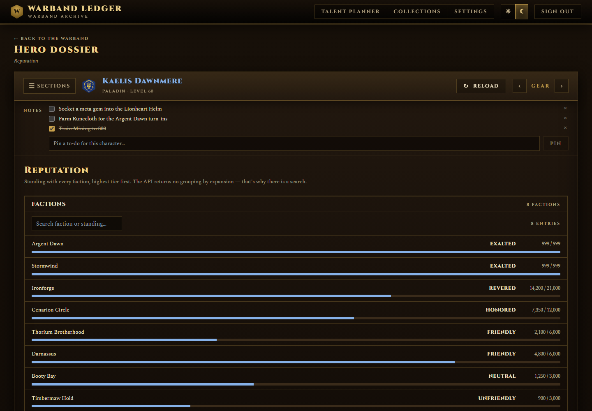
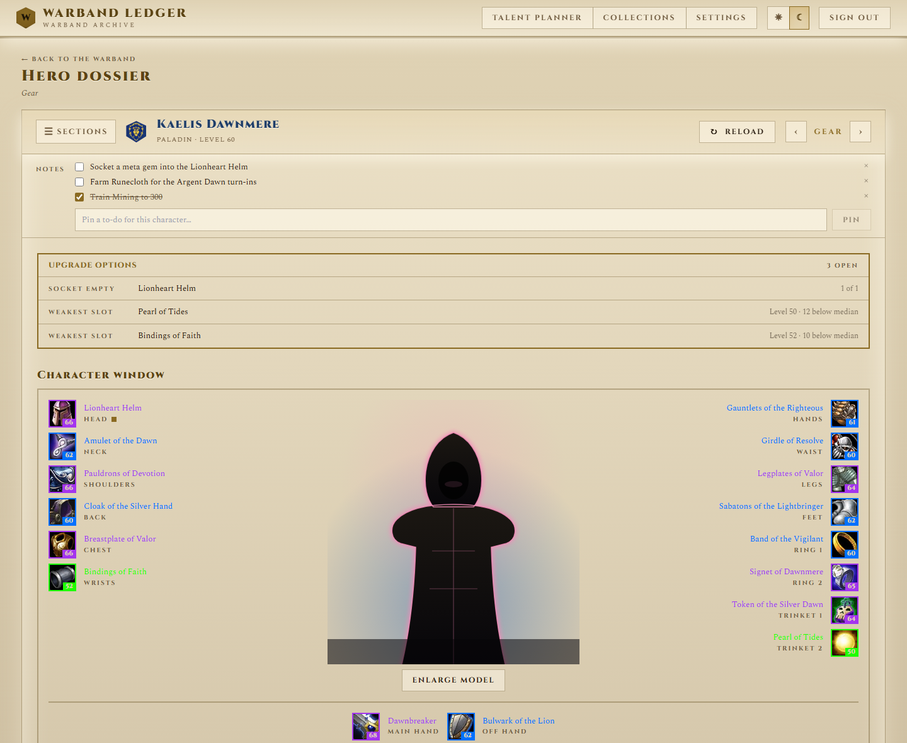

<div align="center">



<br>

**Your whole warband in one ledger.** Every WoW Forever character on your account,
gear the way the character window shows it, the upgrades you are actually missing,
pinned to-dos per hero and a history that writes itself.

<br>

[](#-wow-forever-only)
[](#-sharing-on-your-home-network)
[](#-battlenet-application)
[](#-security)

[](https://nextjs.org)
[](https://react.dev)
[](https://www.typescriptlang.org)
[](https://tailwindcss.com)
[](https://www.prisma.io)
[](https://sqlite.org)
[](https://docs.docker.com/compose/)

**[Tour](#-a-tour-of-the-ledger)** ·
**[Features](#-features)** ·
**[Quick start](#-quick-start)** ·
**[Configuration](#-configuration)** ·
**[Development](#-development-without-docker)** ·
**[How it works](#-how-it-works)** ·
**[Roadmap](#-roadmap)** ·
**[Deutsch](#-deutsche-fassung)**

</div>

> [!NOTE]
> A fan-made tool, not affiliated with Blizzard Entertainment. All data comes from the
> official Battle.net API. World of Warcraft and WoW are trademarks of Blizzard
> Entertainment. The screenshots show **invented demo characters**; real character
> renders are replaced by silhouettes.

---

## 🛡 A tour of the ledger

### The warband

Your five favourite heroes stand on the stage: class icon, faction crest and level at a
glance. Everyone else waits in the list below, grouped by faction, with a filter and a
search.



<details>
<summary><b>⤵ The rest of the roster</b></summary>
<br>

</details>

### The hero dossier

Every character opens as a dossier. Its header sticks to the top while you scroll, the
**Sections** menu slides in from the left, and **‹ ›** leaf through the pages. Right
below sit the character's pinned to-dos, and **Reload** fetches fresh data from Battle.net
whenever the character has logged out.



<table>
<tr>
<td width="50%" valign="top">
<b>📈 History</b><br>
<sub>One snapshot per day becomes a trend on its own: achievement points, recipes, raid kills.</sub>
<br><br>

</td>
<td width="50%" valign="top">
<b>🏳 Reputation</b><br>
<sub>Every faction, highest standing first, with a search because the API does not group by expansion.</sub>
<br><br>

</td>
</tr>
</table>

<details>
<summary><b>☀ Prefer parchment? There is a light theme too</b></summary>
<br>

</details>

---

## ✨ Features

<table>
<tr>
<td width="33%" valign="top">

### ⚔ Warband
- All WoW Forever characters of the account
- Stage for up to five favourites
- Official faction crests and class icons
- Filter by faction, search by name or class
- Loads on demand, not all at once

</td>
<td width="33%" valign="top">

### 🛡 Gear
- **Paperdoll** like the in-game character window
- Item icons in quality colours, hover tooltips
- Character render in the middle, enlargeable
- **Upgrade hints:** missing enchants, empty sockets, weakest slots

</td>
<td width="33%" valign="top">

### 📜 Dossier
- **Pinned notes**: tickable to-dos per character
- **Reload** button per character
- Sticky header, sliding section menu
- Last known state with a timestamp when the API is down

</td>
</tr>
<tr>
<td valign="top">

### 🌳 Talents
- Talent trees of each class, with the character's own points
- **Talent planner**: builds per class, dual spec, a target build per character
- JSON export and import

</td>
<td valign="top">

### 🏰 Guild & economy
- Guild roster, achievements and activity
- Auction house price index
- **Craft economy:** crafting cost against sale price

</td>
<td valign="top">

### 🌐 Everywhere
- English and German, English by default
- Night and parchment themes
- Several Battle.net accounts on one instance, each sees only their own characters

</td>
</tr>
</table>

<details>
<summary><b>📖 Every section of the dossier</b></summary>

| Section | Contents |
| --- | --- |
| **Gear** | Paperdoll, tooltips, character render, upgrade hints |
| **Professions** | Primary and secondary professions, skill tiers, known recipes |
| **Progression** | Raid and dungeon boss kills per difficulty, with dates |
| **Collections** | Titles and toys; mounts and pets account-wide |
| **Achievements** | By category, with point total |
| **Reputation** | Standing with every faction, paragon shown separately, with search |
| **Talents** | Trees of the class, the character's spent points, compared with a target build |
| **PvP** | Honour level, ratings, battleground statistics |
| **Guild** | Members, achievements, events |
| **Economy** | Crafting cost against auction house sale price |
| **History** | Trends from the daily snapshots |

</details>

> [!IMPORTANT]
> **Honest by design.** A missing value shows as `—`, never `0`. A ratio appears only when
> both sides are known. **No DPS numbers, no best-in-slot list, no item scores**: the API
> publishes no stat weights, so any ranking would be invented. When the app assumes
> something, it says so on screen.

---

## 🚀 Quick start

**Requirements:** Docker and Docker Compose.

```bash
git clone https://github.com/VegetaOne/wow-dashboard.git
cd wow-dashboard
docker compose up -d --build
```

Then open <http://localhost:3000>. On the first visit the app walks you through setup:
language, region and your Battle.net client ID and secret. There is no configuration file
to fill in. The values go into the database and can be changed later under **Settings**.

The first build takes a few minutes, because `npm install`, `prisma generate` and
`next build` all run inside the container. After that it starts in seconds.

```bash
docker compose logs -f app      # if something does not come up
docker compose down             # stop; the database volume survives
```

---

## 🔑 Battle.net application

The app reads profile data with each user's own OAuth login, so it needs a client in the
Battle.net Developer Console.

1. Open <https://develop.battle.net> and sign in
2. **Create New Client**, any name, e.g. `wow-dashboard`
3. Set the **Redirect URI** to exactly:

   ```
   http://localhost:3000/api/auth/callback/battlenet
   ```

   To sign in from other devices, add the address with your LAN IP as well, e.g.
   `http://192.168.1.42:3000/api/auth/callback/battlenet`. Every address anyone signs in
   from has to be listed
4. Enter **Client ID** and **Client Secret** on the setup page. It shows the redirect URI
   to copy

The only scope requested is `wow.profile`. The app never reads payment or account data and
never writes anything back to Battle.net.

---

## ⚙ Configuration

Configuration lives in the database, not in a file. Setup comes in two stages:

1. **Before signing in:** language, region, Battle.net client ID and secret. It has to be
   this way round, because without those credentials there is no login to put the setup
   behind. The page checks the credentials against Battle.net before saving
2. **After signing in:** how often the character list refreshes, optionally Warcraft Logs
   credentials

The account that finishes the setup becomes the **owner** of the instance and is the only
one who can change these values later. Changes take effect immediately, without a restart.

The client secret is stored encrypted (AES-256-GCM). The key is generated on first use and
written next to the database as `config.key`. **Back up both together**, or the secret is
lost. The only environment variable left is `DATABASE_URL`, which Compose sets.
`NEXTAUTH_URL` is optional: without it the app derives its address from the request, so
the same instance works over `localhost` and over your LAN IP.

---

## 🏠 Sharing on your home network

Everyone signs in with their own Battle.net account and sees only their own characters.
No data is shared between accounts.

1. Find your local IP: `ipconfig` (Windows), `ipconfig getifaddr en0` (macOS) or
   `hostname -I` (Linux)
2. Add `http://<that-ip>:3000/api/auth/callback/battlenet` as another redirect URI
3. Open the app from the other device at that address. Nothing else to configure

> [!CAUTION]
> There is no HTTPS in this setup. It is built for a home network, not the open internet.
> Exposing it publicly needs a reverse proxy with TLS in front of it.

---

## 🧑‍💻 Development without Docker

```bash
npm install
cp .env.example .env                    # only DATABASE_URL matters
npx prisma migrate dev                  # create the database
npm run dev
```

Then open <http://localhost:3000> and go through the setup.

```bash
npx tsc --noEmit                        # type-check
npm test                                # unit tests (node:test, no extra dependency)
npm run build                           # production build
npx prisma studio                       # inspect the database
```

---

## 🧠 How it works

**Stack:** Next.js 14 (App Router), React 18, Tailwind CSS, NextAuth, Prisma with SQLite.
No external service, no sign-up, no cloud. Fonts (Cinzel, Spectral) are self-hosted.

**Login.** Battle.net is configured as a plain **OAuth2** provider, not OIDC: it writes its
own nonce into the ID token, which makes NextAuth's OIDC check fail with `nonce mismatch`.
The BattleTag comes from the `userinfo` endpoint. Battle.net issues no refresh tokens, so a
login lasts 24 hours.

**Snapshots.** Every dataset is stored per character and per day. A second visit the same
day costs no API request, the history builds itself, and when the API does not answer, the
app shows the last known state with a timestamp instead of an error. **Reload** marks a
character's snapshots as expired and bypasses Next's fetch cache, so the open section is
fetched fresh.

**On-demand loading.** Each dossier section fetches its own data when it is opened; the
character list loads details as sections scroll into view. That keeps pages fast and the
rate limit intact.

<details>
<summary><b>📁 Where things live</b></summary>

```
src/
  app/
    api/wow/                 internal endpoints for on-demand loading and reload
    api/character-notes/     pinned notes per character
    dashboard/[character]/   the hero dossier, one folder per section
    dashboard/talentplaner/  talent planner per class
  components/                UI: warband stage, paperdoll, tooltips, panels, charts
  lib/
    battlenet.ts             API access, namespaces, slots, colours
    character.ts             cached fetches per dataset
    snapshot.ts              daily snapshots, stale fallback, history
    talent-tree.ts           talent rules and comparison (pure)
    notes.ts / note-store.ts notes: limits (pure) / database
    dict/                    English and German dictionaries
prisma/                      schema and migrations
docs/                        concept, order of work, decisions
```

</details>

---

## 🌍 WoW Forever only

Since 2026-11-11 the app covers **WoW Forever only**. Retail, Classic and Classic Era were
removed.

| Data | Namespace |
| --- | --- |
| Profile (account, characters, guilds) | `profile-forever-<region>` |
| Game data | `static-forever-<region>` |
| Rulesets, auction houses | `dynamic-forever-<region>` |

**Blizzard has not documented the Forever API.** The namespaces were found by the
community and may change without notice. Characters have **no realm**; they are addressed
as `{name}-{surname}`, and rulesets replace realms. A 404 usually means *no data yet*:
characters appear from level 10 and after their first logout. The app says so instead of
showing an error. The region defaults to EU and can be changed in the settings.

<details>
<summary><b>⚠ What the API cannot do</b></summary>

- **Profiles update only when the character logs out.** Reloading while you are still in
  the game brings back the old state
- **No stat weights**, hence no DPS figures and no best-in-slot list
- **No loot tables**: the Journal API returns no instances for Forever
- **Gold, currencies and bags** are not in the API at all
- **Never played means 404**, e.g. PvP brackets you never queued for. Those are hidden,
  not shown as empty
- **Rate limits** apply per client. Snapshots and on-demand loading exist for that reason

</details>

---

## 🗺 Roadmap

**In the ledger today:** warband and roster · gear with paperdoll and upgrade hints ·
professions · progression · collections · achievements · reputation · talents and talent
planner · PvP · guild · auction index and craft economy · history · pinned notes ·
reload per character · English/German · night and parchment themes.

| Next | Status |
| --- | --- |
| 🧪 **Setup on a fresh volume** | To be checked end to end |
| 📅 **Weekly overview** | Built, hidden from the navigation until lockouts are confirmed for Forever |
| ⚖ **Character comparison** | Deferred: first decide what to compare |
| 📊 **Warcraft Logs** | Deferred until it is clear whether Warcraft Logs covers Forever |

---

## 🔒 Security

- The client secret lives encrypted in the database and is never displayed or sent back to
  the browser. If it ever lands somewhere else (a chat, a commit, a screenshot), regenerate
  it in the Developer Console
- `config.key` beside the database means a copied database file alone is useless. Anyone
  with filesystem access has both; that is the honest limit
- **The setup page is open until the setup is finished**, because the login needs the
  credentials it collects. On a home network that is a deliberate choice. Finish the setup
  right after the first start
- Session cookies are signed with a key generated during setup
- `.env` is in `.gitignore` and `.dockerignore` and holds nothing secret
- Without HTTPS, tokens should not travel across networks you do not control

---

## 📄 License

Private project, no license granted. If you would like to reuse something, just ask.

---

## 🇩🇪 Deutsche Fassung

<details>
<summary><b>Aufklappen für die deutsche Dokumentation</b></summary>

<br>

**Warband Ledger** (Repo `wow-dashboard`) ist ein selbst gehosteter Companion für den
eigenen World-of-Warcraft-Account: alle Charaktere in WoW Forever, Ausrüstung wie im
Charakterfenster, die Upgrades, die wirklich fehlen, angeheftete Aufgaben je Held und ein
Verlauf, der von selbst entsteht. Läuft als einzelner Docker-Container im Heimnetz; jede
Person meldet sich mit ihrem eigenen Battle.net-Account an.

> [!NOTE]
> Fanprojekt, nicht mit Blizzard Entertainment verbunden. Die Screenshots zeigen
> **erfundene Demo-Charaktere**, Charakterbilder sind durch Silhouetten ersetzt.

### Funktionen

- **Kriegsschar:** bis zu fünf Favoriten auf der Bühne, alle übrigen nach Fraktion,
  mit Filter und Suche
- **Heldenakte:** klebender Aktenkopf, Bereichsmenü, **Notizen** zum Abhaken und ein Knopf
  **Neu laden** je Charakter
- **Ausrüstung:** Paperdoll wie im Spiel, Tooltips, Upgrade-Hinweise (fehlende
  Verzauberungen, leere Sockel, schwächste Slots)
- **Bereiche:** Berufe · Fortschritt · Sammlungen · Erfolge · Ansehen · Talente · PvP ·
  Gilde · Wirtschaft · Verlauf
- **Talentplaner** je Klasse mit Dual-Spec, Ziel-Build je Charakter und JSON-Austausch
- **Englisch/Deutsch**, Themes Nacht und Pergament

> [!IMPORTANT]
> **Ehrlich bei Lücken:** fehlt ein Wert, steht `—` und nicht `0`. Keine DPS-Zahlen, keine
> BiS-Liste, keine Itemwertung: die API liefert keine Statgewichte.

### Schnellstart

```bash
git clone https://github.com/VegetaOne/wow-dashboard.git
cd wow-dashboard
docker compose up -d --build
```

<http://localhost:3000> öffnen. Beim ersten Aufruf fragt die App Sprache, Region und die
Battle.net-Zugangsdaten ab; eine Konfigurationsdatei gibt es nicht. Wer den Setup
abschliesst, wird Besitzer der Instanz und kann die Werte später unter **Einstellungen**
ändern.

### Battle.net-Anwendung

1. Auf <https://develop.battle.net> einen Client anlegen
2. Als **Redirect URI** `http://localhost:3000/api/auth/callback/battlenet` eintragen,
   für Zugriff im Heimnetz zusätzlich dieselbe Adresse mit der lokalen IP
3. **Client ID** und **Client Secret** auf der Einrichtungsseite eintragen

Verwendet wird nur der Scope `wow.profile`. Die App schreibt nichts nach Battle.net.

### Wichtig im Betrieb

- Das Client Secret liegt verschlüsselt in der Datenbank, der Schlüssel als `config.key`
  daneben. **Beides zusammen sichern.**
- Die Einrichtungsseite ist offen, bis der Setup abgeschlossen ist, also gleich nach dem
  ersten Start erledigen.
- Kein HTTPS: fürs Heimnetz gedacht. Wer die App ins Internet stellt, braucht einen Reverse
  Proxy mit TLS.
- Profile aktualisieren sich erst, wenn der Charakter sich ausloggt. **Neu laden** hilft
  danach, nicht vorher.
- Die Forever-API ist nicht dokumentiert; ein 404 heisst meist „noch keine Daten“
  (Charaktere erscheinen ab Stufe 10 und nach dem ersten Ausloggen).

### Entwicklung ohne Docker

```bash
npm install
cp .env.example .env        # nur DATABASE_URL ist relevant
npx prisma migrate dev
npm run dev
```

Prüfen mit `npx tsc --noEmit`, `npm test` und `npm run build`. Konzept, Reihenfolge und
Entscheide stehen in [`docs/`](docs/).

</details>

---

<div align="center">
<sub>Built for the warband · data from the Battle.net API · stays on your own machine</sub>
</div>
